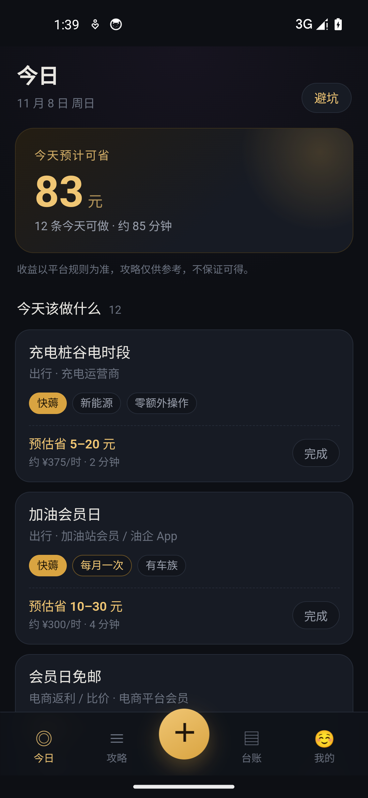
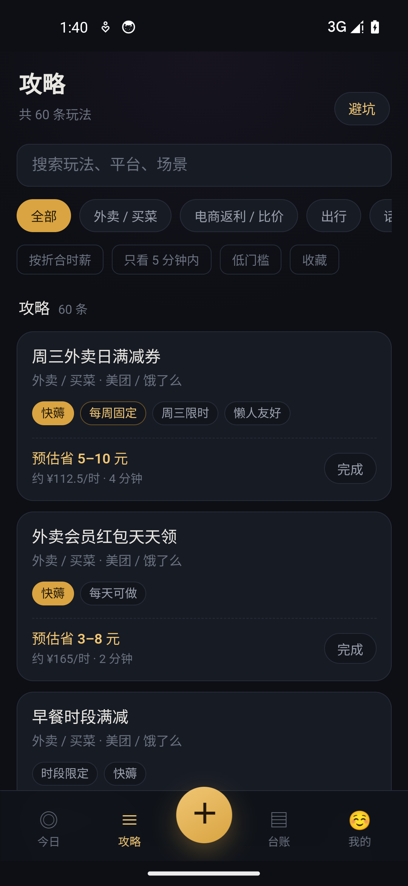
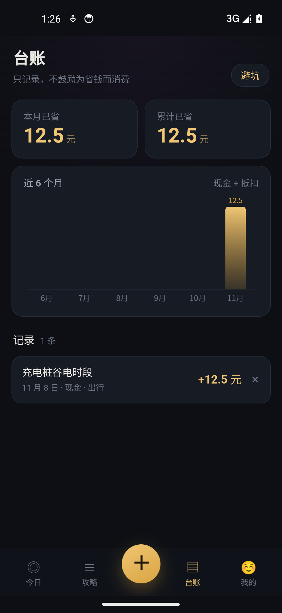
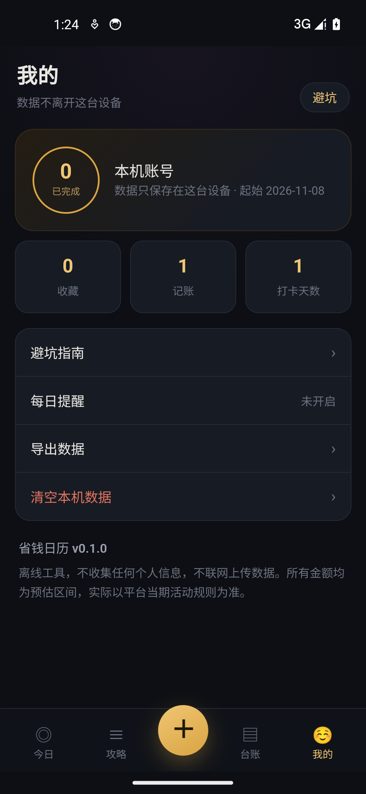

# 省钱日历

> 什么时候能省多少，写清楚。

一个完全离线的安卓省钱攻略工具：把这些年零散在各种 App 里的签到、会员日、满减、立减、返利，按**今天能不能做**重新排一遍，顺手把省下的钱记成台账。

- **不联网**：APK 没有 `INTERNET` 权限，数据不出这台手机
- **不夸大**：所有金额都是「预估区间」，写的是玩法本身，不是保证收益
- **不收违规玩法**：批量账号、绕过风控、虚假交易一律不收录（见[合规红线](#合规红线)）

| 今日清单 | 攻略库 | 台账 | 我的 |
|---|---|---|---|
|  |  |  |  |

---

## 功能

### 今日清单

不用翻攻略，打开就知道今天该做什么。按当天日期和星期自动拼出可做项，并给出预计可省和预计耗时。

- 每日签到、周三外卖日、每月 8 号会员日这类周期性玩法自动出现
- 7 天内结束的活动标出「N 天后到期」
- 打上「快薅」标记的项：5 分钟内能做完、预估收益 ≥ 5 元
- 首页底部还会挑几条「随时可做」的长期玩法，按折合时薪排序

### 攻略库

第一期收录 60 条，分 10 类：外卖买菜、电商返利、出行、话费流量、银行信用卡、会员订阅、签到积分、新客首单、学生企业认证、本地生活。

- 关键词搜索 + 分类筛选
- 按**折合时薪**排序，耗时越长、收益越低的排到后面
- 筛选：只看 5 分钟内 / 低门槛 / 已收藏
- 每条详情写清：预估收益、耗时、折合时薪、前置条件、注意事项、核对时间、有效期

### 资格状态

每条攻略可以标三种状态：**未参与 / 可参与 / 已完成**。标记为已完成的会从今日清单里消失，按周期（每日 / 每周 / 每月）在下个周期自动恢复。

### 收益台账

记一笔分三种：现金红包、券抵扣（记抵掉多少）、实物（记估值）。

- 本月已省 / 累计已省
- 近 6 个月柱状图
- 支持关联具体攻略，也可以自由记录

### 每日提醒

用系统本地通知，每天在你选定的时间提醒一次，不会联网、不会推送营销内容。

### 避坑指南

独立页面，分三块：

- **八种常见套路**：先涨价再打折、券后价才是真价、自动续费陷阱、提现门槛、拉人头返利、押金与预付费、假冒客服退差价、代下单代操作
- **三条黄金守则**：不为折扣买不需要的东西；折合时薪低于上班时薪的玩法不做；要验证码、密码、人脸的一律拒绝
- **被骗了怎么办**：改密码解绑支付 → 保留聊天记录和转账截图 → 平台申诉 + 96110 反诈专线

### 导出

把本机数据（状态、台账、设置）导出成 JSON 复制到剪贴板，自己保存或用别的工具处理。

---

## 权限说明

APK 只声明了本地通知需要的权限：

| 权限 | 用途 |
|---|---|
| `POST_NOTIFICATIONS` | 发送每日提醒 |
| `RECEIVE_BOOT_COMPLETED` | 重启后恢复提醒 |
| `SCHEDULE_EXACT_ALARM` | 让提醒准点触发 |
| `VIBRATE` | 通知震动 |
| `WAKE_LOCK` | 由 Capacitor 本地通知插件引入 |

**没有 `INTERNET` 权限。** App 无法联网，也就不存在上传数据、接收远程指令的可能。所有数据存在 `localStorage`（键名 `shengqian.v1`），卸载即清除。

> 这里刻意不写「零权限」：通知相关的权限是实打实声明的，如实写清楚比标榜无权限更可靠。

---

## 合规红线

以下六类玩法**永远不收录**，不论来源：

| 红线 | 具体表现 |
|---|---|
| 批量账号 | 多开、虚拟号、接码、养号 |
| 绕过风控 | 破解、改包、模拟器刷、自动化脚本、抢购外挂 |
| 虚假交易 | 刷单、空包、虚假下单、套现、退款薅 |
| 代登代操作 | 索要账号密码、代绑卡、代实名 |
| 泄露个人数据 | 要身份证照片、人脸、验证码的「羊毛」 |
| 平台漏洞型 | 利用 bug 少扣钱、白嫖付费内容等明显非授权行为 |

**免责**：所有金额、耗时均为预估，实际以各平台当期活动规则为准。攻略只描述玩法，不保证一定能领到。

---

## 技术栈

- [Capacitor 6](https://capacitorjs.com/) 包一层原生壳，Web 层是原生 HTML / CSS / JS，没有前端框架
- `@capacitor/local-notifications` 负责本地提醒
- [esbuild](https://esbuild.github.io/) 打包 `src/` 到 `www/`
- 存储只用 `localStorage`，没有后端、没有账号体系

目录结构：

```
src/
├─ index.html
├─ css/style.css
├─ data/guides.js       # 内容库（60 条攻略 + 分类 + 避坑条目）
└─ js/app.js            # 应用逻辑（单文件）
tools/
├─ build-www.cjs        # 校验内容库 + esbuild 打包
├─ serve.cjs            # 本地预览服务器（5181）
├─ smoke.cjs            # 无头冒烟测试（21 项）
└─ make-icons.cjs       # 生成图标与启动图
android/                # npx cap add android 生成
```

---

## 本地开发

需要 Node.js 18+。

```bash
npm install
npm run build     # 校验并打包到 www/
npm run serve     # 打开 http://127.0.0.1:5181/
npm run smoke     # 无头冒烟测试，期望 SMOKE_RESULT 21/21 ALL_PASS
```

冒烟测试用无头 Chrome，不会弹出任何窗口。

## 构建安卓包

需要 JDK 17 与 Android SDK 34。

```bash
npm run build
npx cap sync android
cd android
./gradlew assembleRelease
```

发布版签名需要自备 keystore：在 `android/keystore.properties` 里写 `storeFile`、`storePassword`、`keyAlias`、`keyPassword` 四项。**这个文件和 keystore 本身不要提交到仓库**（`.gitignore` 已排除）。

不签名也可以直接 `./gradlew assembleDebug` 装到测试机。

## 内容库校验

`npm run build` 会强制检查：

- 攻略条数必须为 60
- 不允许出现任何外链（保证完全离线）
- `APP_VERSION` 与 `android/app/build.gradle` 的 `versionName` 一致

---

## 更新日志

- **v0.1.0**（2026-11-08）：首个版本。今日清单、60 条攻略库、资格状态、收益台账、每日提醒、避坑指南、数据导出。

---

## 许可

[MIT](LICENSE)
